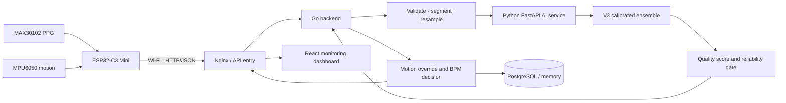

# PURE — Pulse Understanding & Reliability Engine

> AI-powered PPG signal-quality and measurement-reliability support for safer heart-rate monitoring.

PURE evaluates the quality of a photoplethysmography (PPG) window before a
heart-rate value is released to the monitoring dashboard. It combines optical
signal analysis, motion context, a calibrated AI ensemble, a reliability gate,
and corrective guidance. PURE is a **non-diagnostic hackathon prototype** and
is not validated for clinical decision-making.

## Team members

**Team PURE — Universitas Brawijaya, Indonesia**

- Alexa
- Grace
- Jenni
- There

Developed for the **Diva Women in STEM — AI Innovation Hackathon 2026**.

## Selected problem statement

**How can we help bedside nurses verify whether a PPG heart-rate reading is
reliable before the number is displayed?**

## Problem description

PPG is a convenient optical technique for estimating pulse rate, but the signal
is sensitive to motion, unstable sensor contact, low perfusion, clipping, and
other acquisition artifacts. A heart-rate number can still look plausible while
the waveform underneath it is unsuitable for measurement. A dashboard that
shows the number without exposing this uncertainty may create false confidence
and delay corrective action.

PURE focuses on adult patients in relatively stable recovery or observation
settings. It does not diagnose disease or replace clinical assessment. Its role
is to make **measurement reliability visible before the BPM is trusted**.

## Proposed solution

PURE adds a quality-assurance layer between the sensor and the dashboard:

1. Capture a 10-second PPG window and an optional motion summary.
2. Validate, normalize, and resample the waveform for the frozen model.
3. Estimate the probability that the PPG window is usable.
4. Convert that probability into a calibrated quality score and one of three
   operational states: `RELIABLE`, `CAUTION`, or `UNRELIABLE`.
5. Show BPM only when the complete reliability gate accepts the measurement.
6. Withhold BPM and present corrective guidance when signal quality or motion
   evidence is insufficient.

This creates a **Quality-to-Action** workflow rather than merely flagging that
noise exists.

## Key features

- PPG quality assessment before displaying BPM.
- Three-state reliability gate: Reliable, Caution, and Unreliable.
- BPM withholding for rejected or uncertain measurements.
- Corrective guidance for motion, placement, and signal-quality problems.
- Independent MPU6050 motion gate layered on top of optical-model output.
- Live ESP32 sensor ingestion and deterministic replay support.
- Support for sensor sampling rates that can be divided into complete
  10-second windows; the Go backend adapts each segment to the AI contract.
- Patient-monitoring dashboard with waveform, score, status, BPM decision,
  history, motion evidence, and model metadata.
- PostgreSQL persistence for deployment and in-memory mode for rapid demos.
- Frozen-model checksum verification before the AI service reports healthy.
- Fail-closed behavior: an AI-service failure must never be converted into a
  reliable measurement.

## Technology stack

| Layer | Technology |
| --- | --- |
| Wearable prototype | ESP32-C3 Mini, MAX30102 PPG sensor, MPU6050 IMU, LiPo battery |
| Firmware | Arduino/C++, SparkFun MAX3010x library, Wi-Fi, HTTP/JSON |
| Backend | Go 1.27, REST API, DSP heart-rate estimation and signal adaptation |
| AI service | Python 3.11, FastAPI, NumPy, SciPy, PyTorch, scikit-learn, Joblib |
| Dashboard | React 19, TypeScript, Vite 8, Lucide React |
| Storage | PostgreSQL 16 or in-memory repository for demo mode |
| Delivery | Nginx, Docker Compose scaffolding, optional Cloudflare Tunnel |

No LLM API is required. The operational AI is a deterministic biomedical
time-series ensemble hosted by the Python inference service.

## Methodology

### 1. Dataset preparation

- Audit record integrity, subject IDs, quality labels, motion metadata, and
  reference heart rate.
- Use the annotated red PPG channel (`PPG_R`) for RGB records.
- Segment each record as a complete 10-second analytical window at 30 Hz.
- Apply robust normalization and a zero-phase 0.5–5 Hz Butterworth band-pass.
- Derive filtered PPG, first-derivative, and second-derivative views.
- Split by subject, not by record, to prevent person-level leakage.

### 2. Model development

The frozen V3 candidate is a five-fold, subject-wise, equal-weight ensemble of:

1. **Residual 1D-CNN** — learns temporal morphology from filtered PPG and its
   first and second derivatives.
2. **2D CNN on log-STFT** — learns localized time-frequency artifact patterns.
3. **ExtraTrees SQI model** — uses 25 interpretable signal-quality indicators,
   including clipping, entropy, spectral power, autocorrelation, pulse timing,
   template consistency, and derivative statistics.

The three branch probabilities are averaged and calibrated using Platt logistic
calibration fitted only to subject-wise out-of-fold development predictions.

### 3. Reliability policy

The calibrated probability is mapped to a 0–100 quality score. Frozen
development-set thresholds define the prototype policy:

| State | Calibrated score policy | BPM behavior |
| --- | --- | --- |
| Reliable | probability ≥ 0.41068 | Candidate BPM may be displayed |
| Caution | 0.07319 < probability < 0.41068 | BPM withheld; check placement/motion |
| Unreliable | probability ≤ 0.07319 | BPM withheld; repeat measurement |

These values are data-derived prototype operating points, not clinical
standards. `Caution` is an uncertainty region created by PURE; it is not a
native class in BUT PPG.

### 4. Live sensor adaptation

The current firmware captures 1,000 MAX30102 samples at 100 Hz over 10 seconds
and sends a compact MPU6050 motion summary. The Go backend:

- validates the payload and complete-window duration;
- divides longer inputs into 10-second segments;
- resamples each segment to the AI service's 300-sample, 30 Hz contract;
- estimates a candidate BPM with signal processing;
- requests AI quality inference;
- applies the independent motion gate; and
- stores and returns the final quality-to-action decision.

The AI service gates a supplied candidate BPM; it does not independently
estimate heart rate in the current version.

### 5. Validation plan

- Subject-disjoint development and audit evaluation.
- Five-fold subject-wise out-of-fold predictions for candidate selection,
  probability calibration, and threshold selection.
- Metrics: accuracy, balanced accuracy, good-class precision/recall/F1,
  specificity, ROC-AUC, false-acceptance rate, false-rejection rate, reliable
  coverage, and processing latency.
- Separate checks for API validation, model loading, checksums, Go handlers,
  DSP, signal adaptation, and fail-closed behavior.
- Future hardware-domain validation using MAX30102 recordings with reference
  measurements and expert-reviewed quality labels.

## Architecture and workflow



The dashboard communicates with the Go API. It does not call the private AI
service directly.

## Repository structure

```text
pure-pulsesure/
├── apps/
│   ├── ai-service/       # FastAPI inference and preprocessing
│   ├── backend/          # Go API, DSP, quality gate, history
│   └── dashboard/        # React monitoring dashboard
├── data/                 # Dataset documentation; raw data is ignored
├── deploy/               # Nginx and web image configuration
├── documentation/        # API and AI handoff documentation
├── iot/firmware/         # ESP32-C3 + MAX30102 + MPU6050 firmware
├── models/               # Tracked model metadata and evaluation reports
├── notebooks/            # EDA, preprocessing, training, and evaluation
├── scripts/              # Reproducible preparation, training, and smoke tests
├── tests/                 # AI-service tests
└── docker-compose.prod.yml
```

## Installation instructions

### Prerequisites

- Git
- Go 1.27 or newer
- Python 3.11
- Node.js 22 and pnpm/Corepack
- PostgreSQL 16 for persistent history, or `USE_MEMORY=1` for a local demo
- Arduino IDE for the optional wearable firmware

### 1. Clone the integration branch

```bash
git clone https://github.com/itsceyuu/pure-pulsesure.git
cd pure-pulsesure
git checkout dev
```

### 2. Prepare the AI model bundle

The tracked freeze manifest, thresholds, metrics, and SHA-256 inventory are in:

```text
models/production/frozen/v3-ensemble/
```

Large `.pt` and `.joblib` runtime weights are intentionally excluded from Git.
Provision the matching V3 bundle in that directory before starting live AI
inference. The bundle must match `artifact_checksums.json`.

### 3. Start the AI service

macOS/Linux:

```bash
python3.11 -m venv .venv
source .venv/bin/activate
python -m pip install --upgrade pip
python -m pip install -r apps/ai-service/requirements-serve.txt

export PURE_MODEL_BUNDLE_DIR="$PWD/models/production/frozen/v3-ensemble"
export PURE_AI_DEVICE=auto

python -m uvicorn app.main:app \
  --app-dir apps/ai-service \
  --host 127.0.0.1 \
  --port 8001
```

Verify from a second terminal:

```bash
curl http://127.0.0.1:8001/health
python scripts/smoke_test_ai_api.py
```

### 4. Start the Go backend

For a quick in-memory demo:

```bash
cd apps/backend
USE_MEMORY=1 AI_SERVICE_URL=http://127.0.0.1:8001 go run ./cmd/server
```

Windows PowerShell:

```powershell
cd apps/backend
$env:USE_MEMORY="1"
$env:AI_SERVICE_URL="http://127.0.0.1:8001"
go run ./cmd/server
```

Health check:

```bash
curl http://127.0.0.1:8080/api/health
```

To generate deterministic replay data before starting the backend:

```bash
cd apps/backend
go run ./cmd/gendata
```

If `AI_SERVICE_URL` is omitted, the backend uses the dummy quality model for UI
and integration testing. A health response with `inference_type: simulated`
does **not** demonstrate live V3 inference.

### 5. Start the dashboard

```bash
cd apps/dashboard
corepack enable
pnpm install --frozen-lockfile
VITE_API_URL=http://localhost:8080 pnpm dev
```

Open `http://localhost:5173`.

### 6. Optional IoT prototype

1. Open `iot/firmware/esp32c3_max30102/esp32c3_max30102.ino` in Arduino IDE.
2. Install the SparkFun MAX3010x Pulse and Proximity Sensor Library.
3. Select the correct ESP32-C3 board and serial port.
4. Configure Wi-Fi and the reachable backend `/api/measurements` URL.
5. Connect MAX30102 and MPU6050 to the shared I2C bus as documented in the
   firmware header.
6. Flash the device and monitor output at 115200 baud.

Do not commit real Wi-Fi credentials. Use a dedicated demo network and rotate
any credentials that have previously been exposed.

## Usage instructions

### Dashboard workflow

1. Start the AI service, backend, and dashboard.
2. Select a replay session or connect the wearable prototype.
3. Submit a 10-second measurement window.
4. Review the waveform, quality score, reliability state, motion indicators,
   BPM decision, and recommended action.
5. Use history to inspect previous windows and state transitions.

### Main backend endpoints

| Method | Endpoint | Purpose |
| --- | --- | --- |
| GET | `/api/health` | Backend mode and readiness summary |
| GET | `/api/sessions` | Available replay sessions |
| GET | `/api/sessions/{id}` | One replay session |
| POST | `/api/sessions/{id}/analyze` | Analyze a complete replay session |
| POST | `/api/measurements` | Analyze one live/replayed measurement |
| GET | `/api/history` | Retrieve stored assessments |

AI-service details and request/response examples are documented in
[`documentation/AI_API.md`](documentation/AI_API.md).

## Dataset information

PURE uses the **Brno University of Technology Smartphone PPG Database (BUT PPG)
v2.0.0** as the current signal-quality benchmark.

| Attribute | Value |
| --- | --- |
| Records | 3,888 |
| Subjects | 50 |
| Window duration | 10 seconds |
| PPG sampling rate | 30 Hz |
| Native quality labels | Binary good/poor at record level |
| Additional data | Reference ECG; accelerometer for later records |
| License | Creative Commons Attribution 4.0 International |

The development pool contains 3,248 records from 43 subjects. The frozen audit
set contains 640 records from seven subjects. Raw and generated dataset files
are excluded from Git; preparation instructions are available in
[`data/README.md`](data/README.md) and [`notebooks/README.md`](notebooks/README.md).

The dataset was collected using smartphone-camera PPG. It does not establish
performance for the MAX30102 wearable domain.

## Models used

**Frozen candidate:** `pure-ppg-quality-v3-ensemble-2026-10-20`

| Component | Role |
| --- | --- |
| Five residual 1D-CNN folds | Temporal PPG morphology |
| Five 2D CNN folds | Log-STFT time-frequency patterns |
| Five ExtraTrees folds | 25 signal-quality indicators |
| Platt logistic calibrator | Calibrated ensemble probability |
| Go DSP estimator | Candidate BPM calculation |
| MPU6050 rule gate | Independent motion-based override |

Model selection used the highest subject-wise out-of-fold balanced accuracy,
then ROC-AUC, while targeting approximately 10% binary false acceptance. Model
metadata and immutable thresholds are tracked under
`models/production/frozen/v3-ensemble/`.

## Results

The table reports the frozen candidate honestly across development OOF
predictions and the separate seven-subject audit set.

| Metric | Development OOF | Audit set |
| --- | ---: | ---: |
| Accuracy | 86.48% | 73.75% |
| Balanced accuracy | 80.96% | 74.62% |
| ROC-AUC | 89.02% | 82.47% |
| Good-class F1 | 68.30% | 60.75% |
| Binary false-acceptance rate | 9.74% | 27.23% |
| Reliability-gate false-acceptance rate | 4.98% | 17.66% |
| Reliable coverage | 15.95% | 31.09% |

These results demonstrate a working prototype while also showing meaningful
subject/domain shift. The audit set must not be used to retune this frozen
version. A new version requires a new development procedure and an untouched
evaluation set.

Backend verification on the integration branch:

```bash
cd apps/backend
go test ./...
```

All current Go backend packages and tests pass with Go 1.27.3.

## Screenshots and demo

### Dashboard preview


### Submission links

| Demo video | Live prototype |
| --- | --- |
| [Watch the demo video](https://drive.google.com/file/d/1E5B74wU5OoYh8T4NfOUe4aE-SbS2N2JO/view?usp=drive_link) | [Open the live prototype](https://usually-danny-transmit-strongly.trycloudflare.com/) |

The prototype currently uses a temporary Cloudflare Quick Tunnel URL. Verify
both links immediately before submission and ensure the Drive video is shared
without requiring judges to request access.

## Limitations

- PURE is not a diagnostic device and has not undergone clinical validation.
- BUT PPG is smartphone-camera data, while the prototype uses MAX30102; direct
  hardware-domain performance remains unknown.
- Dataset labels are binary and record-level, not temporal artifact masks.
- `Caution` and the two gate thresholds are prototype policy decisions.
- The audit set is not a pristine final clinical test set because its subjects
  were inspected during earlier development.
- The external audit result is below the desired target and indicates subject
  or acquisition-domain shift.
- MPU6050 motion thresholds are engineering heuristics, not clinical limits.
- Heart rate is estimated by backend DSP and only gated by the current AI API.
- Model runtime binaries are not stored in Git and must be provisioned with
  checksum verification.
- Quick `trycloudflare.com` tunnels are temporary development links, not a
  reliable final hosting strategy.
- Current deployment scaffolding still requires end-to-end packaging and
  hardware-network validation before production use.

## Future scope

- Collect synchronized MAX30102, MPU6050, and reference ECG data across users,
  skin tones, sensor placements, activities, and perfusion conditions.
- Create expert-reviewed temporal artifact annotations and clinically motivated
  operating points.
- Retrain and validate a hardware-domain model on a genuinely untouched cohort.
- Compare the ensemble with modern temporal architectures and distillation
  strategies while preserving calibration and interpretability.
- Add drift monitoring, uncertainty monitoring, audit logs, and model-version
  rollback.
- Validate BPM error conditional on acceptance, rejected-window safety, and
  latency under realistic workloads.
- Replace temporary tunnels with a stable authenticated deployment.
- Add MQTT buffering, reconnect behavior, secure device identity, encrypted
  transport, and over-the-air firmware configuration.
- Conduct usability testing with nurses before any patient-care deployment.

## External resources and attributions

### Dataset

Nemcova, A., Smisek, R., Vargova, E., Marsanova, L., Vitek, M., Smital, L.,
Filipenska, M., Sikorova, P., and Galik, P. (2024). *Brno University of
Technology Smartphone PPG Database* (version 2.0.0). PhysioNet.
[https://doi.org/10.13026/tn53-8153](https://doi.org/10.13026/tn53-8153)

### Hardware and software

- [SparkFun MAX3010x Sensor Library](https://github.com/sparkfun/SparkFun_MAX3010x_Sensor_Library)
- [FastAPI](https://fastapi.tiangolo.com/)
- [PyTorch](https://pytorch.org/)
- [scikit-learn](https://scikit-learn.org/)
- [React](https://react.dev/) and [Vite](https://vite.dev/)
- [Go](https://go.dev/)
- [PostgreSQL](https://www.postgresql.org/)
- [Docker](https://www.docker.com/) and [Nginx](https://nginx.org/)
- [Cloudflare Tunnel](https://developers.cloudflare.com/cloudflare-one/connections/connect-networks/)

Third-party dependencies remain subject to their respective licenses. Project
assets must be checked for publication rights before final distribution.

## Responsible-use notice

PURE supports measurement-quality decisions only. It must not be used to
diagnose, treat, triage, or independently determine patient care. Clinical and
regulatory validation is required before use in real care environments.
